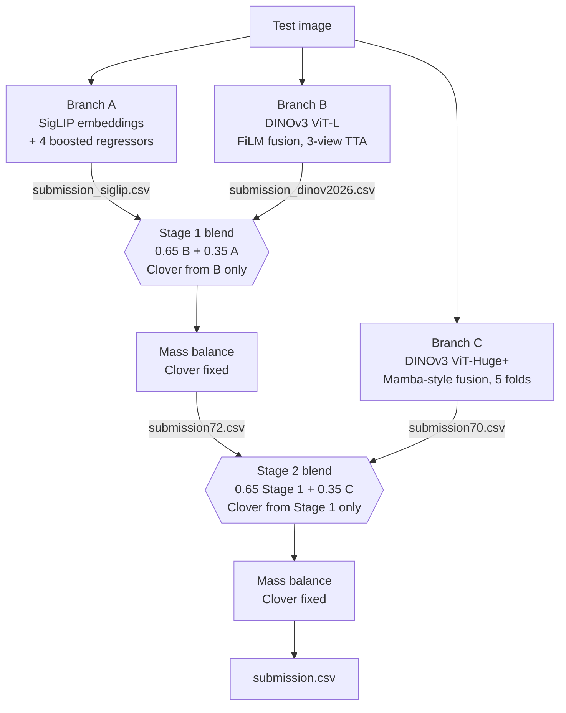

# Pasture Biomass from Images

A multi-model ensemble for the **CSIRO Image2Biomass Prediction** Kaggle competition. Given a photo of a pasture quadrat, the pipeline predicts five dry-mass targets (in grams). It blends **three very different model families** (a SigLIP-embedding + gradient-boosting stack, a DINOv3 ViT-Large regressor with FiLM fusion, and a DINOv3 ViT-Huge+ regressor with a Mamba-style fusion neck) and then enforces the biological mass-balance constraints between targets.

The repo also includes a clean **ConvNeXt-Tiny** baseline notebook as a simpler reference point.

---

## Table of Contents

- [Problem](#problem)
- [Ensemble Architecture](#ensemble-architecture)
- [Branch A: SigLIP Embeddings + Gradient Boosting](#branch-a-siglip-embeddings--gradient-boosting)
- [Branch B: DINOv3 ViT-Large + FiLM Fusion](#branch-b-dinov3-vit-large--film-fusion)
- [Branch C: DINOv3 ViT-Huge+ + Mamba-Style Fusion](#branch-c-dinov3-vit-huge--mamba-style-fusion)
- [Blending and Mass-Balance](#blending)
- [Evaluation Metric](#evaluation-metric)
- [Results](#results)
  

---

## Problem

Estimate the amount of usable feed in a pasture from a single RGB image.

| Target | Meaning |
|---|---|
| `Dry_Green_g` | Dry mass of green vegetation (excluding clover) |
| `Dry_Dead_g` | Dry mass of dead plant material |
| `Dry_Clover_g` | Dry mass of clover |
| `GDM_g` | Green dry matter, `Dry_Green_g + Dry_Clover_g` |
| `Dry_Total_g` | Total dry mass, `GDM_g + Dry_Dead_g` |

This is a **multi-output regression** problem with built-in physical constraints: only three targets are independent, and the other two are sums of them.

Each source image is wide (about 2000×1000). Every vision branch below splits it into **left and right halves** and processes each half separately.

---

### What `chaos-of-ensembles.ipynb` contains

| Cell | Role | Output |
|---|---|---|
| 0 | Branch A: SigLIP embeddings, semantic features, 4 boosted regressors | `submission_siglip.csv` |
| 1–2 | Branch B: writes and runs `csiro_infer.py` (DINOv3 ViT-L, FiLM) | `submission_dinov2026.csv` |
| 3 | **Stage-1 blend** of A and B + mass balance | `submission72.csv` |
| 4 | Sanity check that the installed `timm` exposes DINOv3 models | none |
| 5–12 | Branch C definitions: DINOv3 ViT-Huge+, Mamba fusion, losses, 5-fold training loop (training loop is commented out; weights are loaded) | none |
| 13 | Branch C 5-fold inference + derived targets | `submission70.csv` |
| 14 | **Stage-2 blend** of Branch C and the stage-1 blend + mass balance | `submission.csv` (final) |

---

## Ensemble Architecture



### Effective weights in the final prediction

Because the blend is applied in two stages, the weight of each model in the final non-clover targets is the product of the two stage weights.

| Model | Stage-1 weight | Stage-2 weight | **Effective weight** |
|---|---|---|---|
| Branch B: DINOv3 ViT-L (FiLM) | 0.65 | 0.65 | **0.4225** |
| Branch A: SigLIP + boosting | 0.35 | 0.65 | **0.2275** |
| Branch C: DINOv3 ViT-Huge+ (Mamba) | n/a | 0.35 | **0.3500** |

`Dry_Clover_g` is the exception: it comes **only from Branch B** at both stages (see [Design Notes](#design-notes)).

---

## Branch A: SigLIP Embeddings + Gradient Boosting

A classical-ML branch that treats a frozen vision-language model as a feature extractor. It gives the ensemble diversity because it shares no training dynamics with the fine-tuned ViTs.

### 1. Tiled embedding extraction

- Backbone: **`google/siglip-so400m-patch14-384`** (frozen), producing 1152-d image embeddings.
- Each full image is tiled into overlapping **520×520 patches** (overlap 16 px, stride 504, edge patches shifted inward so all tiles are the same size).
- All patches go through the SigLIP image encoder and are **mean-pooled** into one embedding per image.
- Unreadable images fall back to a zero vector so the pipeline never crashes.

### 2. Zero-shot "semantic probing" features

Text embeddings for hand-written concept prompts are compared (cosine similarity) against each normalized image embedding:

| Concept group | Example prompts |
|---|---|
| `bare` | "bare soil", "exposed earth" |
| `sparse` | "thin grass", "short clipped grass" |
| `medium` | "average pasture cover", "grazed pasture" |
| `dense` | "dense tall pasture", "high biomass" |
| `green` | "lush green vibrant pasture", "fresh growth" |
| `dead` | "dry brown dead grass", "standing hay" |
| `clover` | "white clover", "trifolium repens" |
| `grass` | "ryegrass", "fescue", "grassy sward" |

Three ratio features are added: `greenness = green/(green+dead)`, `clover_share = clover/(clover+grass)`, and `cover = (dense+medium)/(bare+sparse)`. The result is 11 interpretable features per image.

### 3. Supervised embedding engine

A `SupervisedEmbeddingEngine` is fit **inside each fold** (no leakage) and compresses the 1152-d embedding into a compact, target-aware feature set:

| Component | Setting | Purpose |
|---|---|---|
| `StandardScaler` | n/a | Normalize embedding dimensions |
| `PCA` | keeps 80% variance | Unsupervised compression |
| `PLSRegression` | 8 components | Supervised projection toward the targets |
| `GaussianMixture` | 6 components, diagonal covariance | Soft cluster membership (posterior probabilities) |
| Semantic features | z-scored | Interpretable concept scores |

### 4. Boosted regressors

Targets are **max-scaled** using fixed per-target maxima, then one model is trained per target. Four different regressors are trained and averaged:

| Model | Key hyperparameters |
|---|---|
| `HistGradientBoostingRegressor` | 300 iterations, lr 0.05, L2 0.44 |
| `GradientBoostingRegressor` | 1354 trees, lr 0.010, depth 3, subsample 0.60 |
| `CatBoostRegressor` | 1900 iterations, lr 0.045, depth 4, L2 0.56 |
| `LGBMRegressor` | 807 trees, lr 0.014, 48 leaves, L1 0.21, L2 3.78 |

Training follows a **5-fold scheme** using a precomputed `fold` column from a shared data-split CSV. Test predictions are averaged across folds, then across the four models.

### 5. Post-processing

`Dry_Clover_g` is fixed at **0.0** in this branch. `GDM_g` and `Dry_Total_g` are derived from the predicted green and dead values, then clipped at zero.

---

## Branch B: DINOv3 ViT-Large + FiLM Fusion

An end-to-end fine-tuned vision transformer, run as inference over pretrained fold models (`csiro_infer.py`, written and executed from the notebook).

### Architecture

- **Backbone**: `vit_large_patch16_dinov3_qkvb` from `timm` (global average pooled features), input **512×512**.
- Left and right image halves pass through a **shared backbone**, giving two feature vectors.
- **FiLM conditioning**: the mean of the two halves forms a context vector. A small MLP maps it to per-feature scale (γ) and shift (β), which modulate *both* halves: `f' = f · (1 + γ) + β`.
- The modulated features are concatenated and fed to **three independent heads** (Green, Clover, Dead), each `Linear → ReLU → Dropout → Linear(8→1)` with a **Softplus** output to guarantee non-negative masses.

### Inference

- **Fold ensemble**: every `.pth` checkpoint in the models directory is loaded and predictions are averaged.
- **3-view TTA**: original, horizontal flip, vertical flip, averaged per model.
- **Post-processing heuristics**:
  - Predictions below 0.09 g are zeroed (noise floor).
  - `Dry_Clover_g` is scaled by 0.8.
  - `Dry_Dead_g` is scaled by 1.1 when above 20 g and by 0.9 when below 10 g.

---

## Branch C: DINOv3 ViT-Huge+ + Mamba-Style Fusion

The largest model in the ensemble, with a custom token-level fusion neck.

### Architecture

| Stage | Detail |
|---|---|
| Backbone | `vit_huge_plus_patch16_dinov3.lvd1689m`, 512×512 input, **patch tokens kept** (`global_pool=''`) |
| Input | Left and right halves through a shared backbone |
| Token fusion | Left and right token sequences **concatenated along the sequence axis** `(B, 2N, D)` |
| Fusion neck | 2× `LocalMambaBlock` |
| Pooling | Adaptive average pooling over tokens |
| Heads | Green, Clover, Dead: `Linear(D→D/2) → GELU → Dropout(0.2) → Linear(D/2→1) → Softplus` |
| Derived outputs | `GDM = Green + Clover`, `Total = GDM + Dead` (built into the forward pass) |

**`LocalMambaBlock`** is a lightweight, linear-complexity gated block: `LayerNorm → sigmoid gate → depthwise Conv1d (kernel 5) → linear projection → residual`. It lets tokens from the left half interact with tokens from the right half without quadratic attention cost.

### Training recipe (loop included in the notebook, commented out)

| Setting | Value |
|---|---|
| Cross-validation | `StratifiedGroupKFold`, 5 folds, grouped by `Sampling_Date`, stratified by `State` |
| Optimizer | AdamW, backbone LR 5e-4, heads/neck LR 1e-3, weight decay 1e-2 |
| Schedule | 3 warmup epochs then cosine decay |
| Batch | 1 per step with 4-step gradient accumulation |
| Stability | bf16 autocast, gradient clipping at 1.0, **EMA of weights** (decay 0.9) |
| Loss | Huber (`SmoothL1`, β = 5) on the three primary targets (Green, Dead, Clover) |
| Model selection | Best **global weighted R²** per fold, EMA weights saved, patience 5 |
| Preprocessing | Crop the bottom 10% of the image and inpaint the orange date stamp (HSV mask + Telea inpainting) |
| Augmentation | Flips, 90° rotations, small rotations (±10°), light color jitter |

### Inference

Five fold checkpoints are loaded one at a time and averaged. Only `[Total, GDM, Green]` are read from the model, and the remaining targets are derived:

```
Dry_Clover_g = max(0, GDM − Green)
Dry_Dead_g   = max(0, Total − GDM)
```

---

## Blending and Mass-Balance Reconciliation

### Weighted blend

For every target except clover, the two inputs are combined with a normalized weighted average. Both submission files are sorted by `sample_id` and checked for exact ID alignment before blending.

### Mass-balance step

After blending, the five targets are made physically consistent. With clover held fixed:

```
GDM_g       = Dry_Green_g + Dry_Clover_g
Dry_Total_g = GDM_g + Dry_Dead_g
```

All values are then clipped at zero. `Dry_Green_g` and `Dry_Dead_g` remain exactly as blended.

The code also contains a general **orthogonal-projection** reconciliation (used when clover is *not* fixed). It finds the closest point to the raw predictions that satisfies both constraints, using the constraint matrix

```
C = [[1, 1, 0, -1,  0],      # Green + Clover − GDM = 0
     [0, 0, 1,  1, -1]]      # Dead + GDM − Total   = 0

P = I − Cᵀ (C Cᵀ)⁻¹ C       # projection onto the constraint-satisfying subspace
```

---

## Evaluation Metric

The competition uses a **weighted R²** across the five targets, which makes `Dry_Total_g` count for half of the score.

| Target | Weight |
|---|---|
| `Dry_Green_g` | 0.1 |
| `Dry_Dead_g` | 0.1 |
| `Dry_Clover_g` | 0.1 |
| `GDM_g` | 0.2 |
| `Dry_Total_g` | 0.5 |

Because `Dry_Total_g` dominates, the total-mass prediction (which sums the green, clover, and dead components) matters most, and the mass-balance step keeps it consistent with the parts.

---

## Results

| Model / Stage | Local CV (weighted R²) | Public LB |
|---|---|---|
| Branch A: SigLIP + boosting | _add_ | _add_ |
| Branch B: DINOv3 ViT-L (FiLM) | _add_ | _add_ |
| Branch C: DINOv3 ViT-Huge+ (Mamba) | _add_ | _add_ |
| Stage-1 blend (A + B) | n/a | _add_ |
| **Final blend (A + B + C)** | n/a | _add_ |

### Smoke test on the sample test image

The saved notebook outputs were run against Kaggle's one-image placeholder test set, so they show the mechanics rather than a score. For that single image:

| Target | Branch A (SigLIP) | Branch C (Huge+) | Final blend |
|---|---|---|---|
| `Dry_Green_g` | 29.68 | 26.58 | 28.87 |
| `Dry_Dead_g` | 22.94 | 32.42 | 33.74 |
| `Dry_Clover_g` | 0.00 | 0.26 | 0.00 |
| `GDM_g` | 29.68 | 26.84 | 28.87 |
| `Dry_Total_g` | 52.62 | 59.26 | 62.60 |

The final row is consistent by construction: `GDM = Green + Clover` and `Total = GDM + Dead`.


